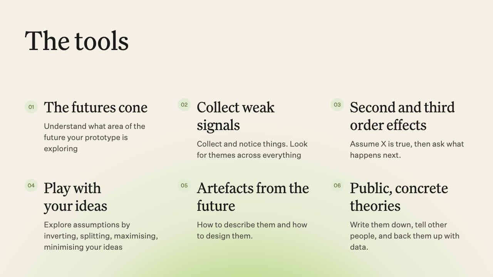
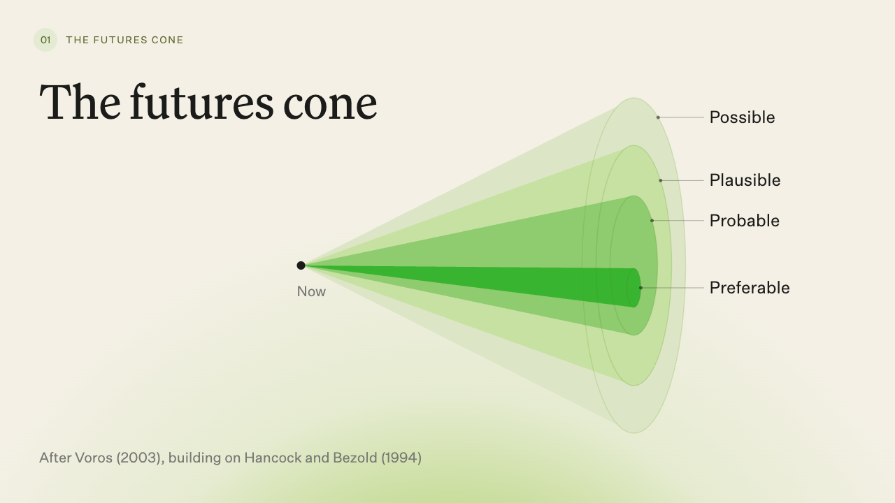

# Fortune Telling and Speculative Design

The source code, slides and speaker notes for Maggie Appleton’s talk at Granola Design Engineer Night, 15 October 2026.

How can we develop more rigorous theories of the future? This talk explores ways to notice emerging changes, question our assumptions and make ideas about the future tangible enough to test and discuss.

It draws on speculative design, a practice with roots in industrial design, including work by Anthony Dunne and Fiona Raby at the Royal College of Art. Alongside examples from GitHub Next, it brings together futures thinking and creative thinking exercises that designers and engineers can use in their own work.

The tools include collecting weak signals, following second- and third-order effects, inverting assumptions, imagining abundance and scarcity, and creating artefacts from possible futures. Making theories public and concrete gives us something to test against reality and refine.





## How to view

[Browse the slide images](slide-images/) to read the deck without running anything. Each image shows a finished slide with all click reveals visible; video slides use still frames.

For the full presentation, including animations, videos and speaker notes, run it locally using the instructions below. The deck uses Reveal.js 6.0.2:

- **→ / Space:** advance; click-to-reveal steps appear before the next slide.
- **←:** go back.
- **S:** speaker view with notes and timer. Allow popups for the local address.
- **F:** fullscreen.
- **Esc:** slide overview.
- **B:** black screen.

## How to actually run the project and use it

Use Node.js 22.12 or newer. Clone the repository, install dependencies and start the local server:

```sh
git clone https://github.com/MaggieAppleton/fortune-telling-talk.git
cd fortune-telling-talk
npm ci
npm run dev
```

Open **http://127.0.0.1:5173** and keep the server running while presenting. If you already have the repository, start with `npm ci` inside its folder.

Fonts, images and videos are bundled locally, so presenting needs no Wi-Fi once dependencies are installed. Videos play muted and looping, with controls.

Media is optimised for presentation: videos are up to 2400 pixels wide for sharp playback at 1200 pixels wide on Retina screens, and images use lossless WebP where it saves space. Optimise new media before committing and keep full-resolution source recordings outside this repo.

## Build

```sh
npm run build
npm run preview
```

Open **http://127.0.0.1:4173**. The generated `dist/` folder contains the presentation and its media, ready to serve from any local web server.
